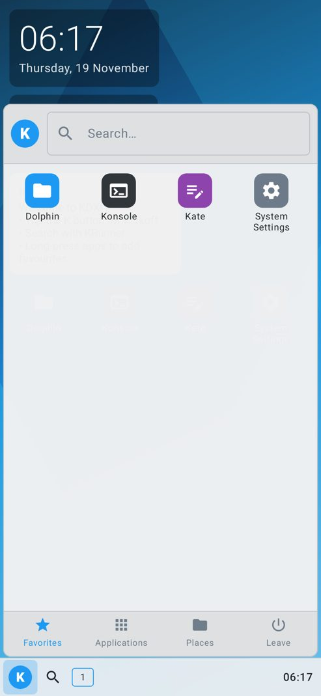
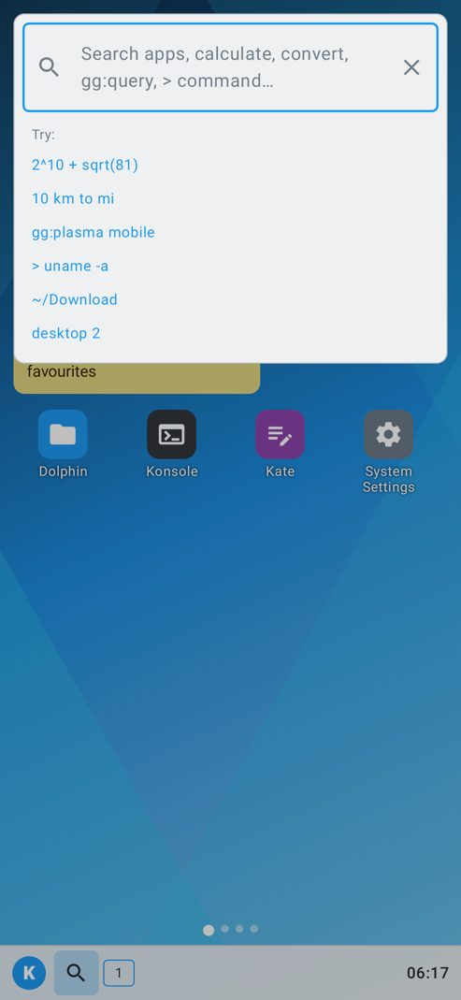
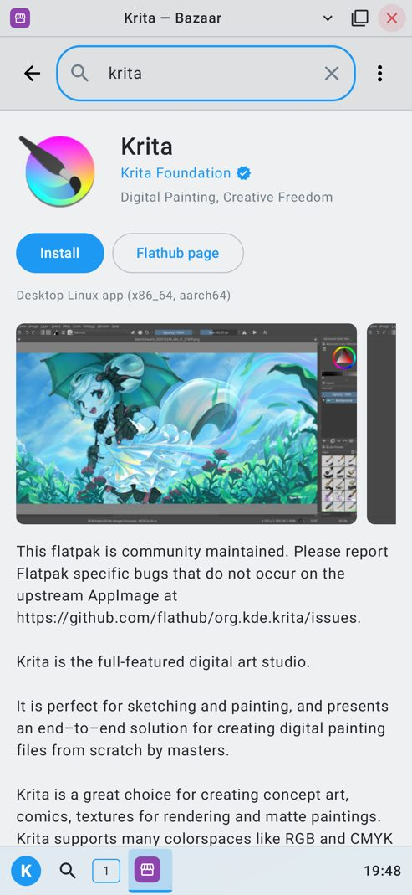

# KDX: a KDE Plasma–style workspace for Android

KDX is a native Android app (Kotlin + Jetpack Compose) that brings the KDE Plasma
desktop experience to phones, tablets and desktop-mode Android (DeX, Chromebooks, external displays).
It runs as a **home-screen launcher**, so it can fully replace your Android home screen.

| Desktop | Kickoff | KRunner | Floating windows |
|---|---|---|---|
|  |  |  |  |
| **Overview** | **Breeze Dark** | **Clock & calendar** | **Konsole** |
|  |  |  |  |

## Features

### Plasma shell
- **Panel** with application launcher, KRunner button, pager, task manager and system tray (battery, clock, Klipper). Can sit at the bottom or the top.
- **Kickoff** launcher: Favorites, all applications (KDX apps plus every installed Android app) with categories, Places, and Leave. Search ranks matches. Long-press an app to favourite it, open App info or uninstall it.
- **KRunner**: calculator (`2^10 + sqrt(81)`), unit conversion (`10 km to mi`, `72 f in c`), web shortcuts (`gg:`, `dd:`, `wp:`, `yt:`, `gh:`, `kde:`, `map:`, `play:`), URLs, paths (`~/Download`), shell commands (`> uname -a`), open windows, Android settings pages, clipboard history and desktops (`desktop 2`).
- **Window manager** (a small KWin): floating or maximized windows that you can move, resize, minimize, maximize, close, and keep above others. Includes the window menu, click-to-focus and cascade placement.
- **Virtual desktops** (1–8): pager in the panel, swipe on the wallpaper to switch, and "Move to Desktop N" for windows.
- **Overview**: the desktop strip plus a grid of the open windows.
- **Desktop widgets**: Digital Clock, System Load and a Sticky Note. The clock pops up a month calendar.
- **Breeze theming**: Breeze Light / Dark / follow Android, 10 accent colours, 5 built-in wallpapers or your own image.
- **Plasma keyboard shortcuts** for hardware keyboards: Meta, Alt+Space, Alt+F2, Meta+W, Meta+D, Alt+Tab, Alt+F4, Meta+↑/↓, Ctrl+F1–F8, Ctrl+Meta+←/→, Ctrl+Alt+T, Meta+E, Meta+V.

### KDE applications, rebuilt for Android
| App | What it does |
|---|---|
| **Dolphin** | File manager: Places, breadcrumbs, back/forward/up, list and grid views with thumbnails, filter, hidden files, multi-select, copy/cut/paste between windows, rename, delete, properties, share, "Open with…", "Open Terminal Here" |
| **Konsole** | Terminal on Android's `sh`: streaming output, stdin to running programs, Ctrl+C, history, Tab completion, extra-keys row, `cd`, plus built-ins that open KDX apps |
| **Kate** | Text editor: line numbers, find & replace, undo/redo, word wrap, zoom, Save / Save As, status bar |
| **KCalc** | Scientific calculator: memory, degrees/radians, history tape |
| **Gwenview** | Image viewer: thumbnail browser, pinch zoom, next/previous, share, set as wallpaper |
| **Klipper** | Clipboard history with search |
| **KNotes** | Sticky notes (shared with the desktop widget) |
| **System Monitor** | Live memory and CPU-frequency graphs, battery, storage, uptime |
| **Info Center** | Software, hardware and display information |
| **System Settings** | Wallpaper, colours, desktops, panel, widgets, clock, shortcuts, Android integration |

## Linux system: DroidSystem 2 (Debian-based)
Turn it on in **System Settings → Linux System (DroidSystem)**. DroidSystem 2 is **based on Debian** and runs real
Linux software:

- **Real Debian** – KDX builds it like `debootstrap` does: it downloads the official Debian trixie packages for your
  phone's CPU (arm64, armhf or amd64; about 35 MB, SHA-256 verified) and installs them, then adds the DroidSystem layer
  (branding, apt settings for proot, tools). It runs with **proot** (bundled, from Termux), so no root is needed.
- **apt works** in Konsole (`apt install cowsay`, `apt install gnome-mines`, …) – Konsole is a real Debian `bash`.
- **Linux apps with windows** each get **their own KDX window** with the app's **title** (live, e.g. the open
  document) and **icon** in the title bar and panel. Behind each window is its own X display (TigerVNC + Openbox,
  no extra title bar, app maximized) that **resizes to fit the window**. The **mouse pointer is hidden**, and input
  works like a **touchscreen**: tap = click, drag = scroll, long-press = right-click, long-press + drag = drag, two
  fingers = scroll / pinch-zoom (a Mouse mode is one tap away). Keyboard and Ctrl/Alt/Super/Esc/arrow keys are in
  the toolbar. The window closes when the app quits. Set up with `display-setup` (or the button in Settings), then
  run apps from Kickoff → Linux, Bazaar, or `gui <app>` in Konsole.
- **Flatpak** – `flatpak-setup` installs the real Flatpak and adds Flathub. Installing from **Bazaar** runs
  `flatpak install` for you, and **Open** starts the app on the Linux Display. Flatpak's own sandbox (bubblewrap) needs
  kernel features Android doesn't give apps, so KDX starts Flatpak apps itself in the same layout (runtime as `/usr`,
  app as `/app`, Flatpak's environment) using proot. It mounts **runtime and app extensions** (Mesa GL drivers,
  codecs, themes, plugins) the way Flatpak does, provides a **D-Bus session bus**, forces X11 for Wayland-first and
  Electron apps, and turns off Chromium/Electron's internal sandbox (it needs kernel namespaces). Libraries that
  run helpers in their own bubblewrap sandbox – glycin (image loading in GNOME 47+ apps) and WebKitGTK – are given a
  `bwrap` that reports "no namespaces", so they run the helpers directly instead of failing. Verified with
  **Kitties** (`io.github.Micro856.KittiesGtk`, GNOME 51 runtime): it starts, fetches and shows pictures.
  Firefox's own sandboxes (seccomp/namespaces) are turned off with Mozilla's `MOZ_DISABLE_*_SANDBOX` variables, as
  Termux users do; **Firefox** (`org.mozilla.firefox`) starts and renders pages this way.
- **Sound**: PulseAudio runs inside DroidSystem with a virtual speaker; apps (Debian and Flatpak) send audio over
  TCP, and KDX plays the speaker's output through Android. Set up with `sound-setup` (included in `display-setup`),
  toggle in System Settings → Linux System.
- **Up to 60 fps**: the X server is capped at 60 fps and pushes frames as they change (RFB Continuous Updates +
  Fence); pixels arrive in Android's own byte order and go to a double-buffered Bitmap with one native copy. KDX's
  client sustains 60+ fps at 1280×800; the real rate depends on how fast the app itself draws (software rendering).
- **Full speed for Linux apps**: while any Linux app is open, KDX runs as a foreground service (notification
  "DroidSystem is running") so Android doesn't freeze, throttle or kill it, and holds a partial wake lock so apps keep
  running with the screen off. **Auto performance mode** (default) watches each window's frame rate and lowers its
  render resolution when an animating app can't reach 60 fps, raising it again when there's headroom (measured here:
  a heavy software-3D app went from 13 to ~53 fps); Sharp / Balanced / Fast are fixed alternatives. Each app window
  shows its current fps.
- **On-screen keyboard**: Linux app windows show the keyboard whenever they're active (and bring it back after taps);
  the window shrinks above it and the app resizes. Toolbar button / Settings switch to turn it off.
- **More file types in Dolphin** (with DroidSystem 2): `.AppImage` runs in its own window (it unpacks itself, no
  FUSE needed), Linux programs (ELF) run in Konsole, scripts (`.py .pl .rb .js .lua .php .tcl .sh`) ask Run/Edit and
  install their interpreter on first use, `.jar` runs with Java, `.deb` installs through Debian's real apt, `.flatpak`
  bundles and `.flatpakref` go to real Flatpak, fonts (`.ttf .otf .woff`) install for Linux apps, `.apk` opens Android's
  installer, and ISO/RAR/zstd/lz4/CAB/LHA/XAR archives extract through Debian's bsdtar. Windows `.exe`/`.msi` get an
  explanation.
- If a Linux app stops right after starting or with an error, its window stays open and explains why (e.g. Android
  ended it for memory, a blocked system call, a crash) with the app's log, **Restart** and **Copy log**. Not supported:
  "extra-data" apps that download proprietary files at install time (they need bubblewrap), and apps that require a
  real GPU (rendering is software-only).
- Installed Debian and Flatpak apps appear in **Kickoff → Applications → Linux** with their own icons.

To run downloaded programs KDX must target **Android 9** (like Termux), so it's installed by sideloading rather than
from Google Play. See [THIRD_PARTY_NOTICES.md](THIRD_PARTY_NOTICES.md) for the bundled proot binaries.

**What's tested:** the Debian bootstrap, apt, the X display + VNC client and the Flatpak launcher are exercised by
`DebianIntegrationTest` (`./gradlew testDebugUnitTest -Pkdx.integration=/tmp/kdx-it`) on x86_64 Linux. Running
`flatpak install` itself needs a proot that handles modern system calls such as `statx` – Termux's proot (the one
bundled for phones) does; older distribution proot builds don't.

### DroidSystem's own layer
DroidSystem's folder lives in the phone's **Android folder**: `/storage/emulated/0/Android/DroidSystem` (on a PC:
`…/Internal storage/Android/DroidSystem`). If Android refuses new folders there, KDX uses
`Android/data/org.kdx.shell/files/DroidSystem` instead – also inside the Android folder, but removed when KDX is
uninstalled. Installs from older versions at `/storage/emulated/0/DroidSystem` are moved automatically. The Debian
system files themselves stay in KDX's private storage, because Android doesn't allow programs or symlinks on shared
storage.

DroidSystem also keeps its original, fully offline layer in that folder (mounted at
`/home/user` inside Debian), bundled inside the APK (`app/src/main/assets/droidsystem`):

| Settings | Bazaar | Flathub app | DroidSystem app |
|---|---|---|---|
|  |  |  |  |

- **Bazaar** (installed by default): a graphical app store. It loads the **live Flathub catalog** (trending, popular,
  new, ten categories, search) with real icons, screenshots, descriptions, sizes, install counts and permissions, and
  caches it for offline use. Flathub apps are desktop Linux programs Android can't run, so their Install button explains
  that and offers to save the `.flatpakref` (for a Linux PC) or find an Android version on Google Play. Apps marked
  **Runs on DroidSystem** install, open, update and remove with one tap. The Flathub catalog can be turned off from
  Bazaar's menu. Open Bazaar from Kickoff or type `bazaar` in Konsole.

- **File system**: `etc/` (os-release, passwd, motd, profile), `home/user`, `usr/bin`, `usr/share/applications`, `var/lib/{dspkg,flatpak}`, …
- **Konsole becomes a DroidSystem shell** (`user@droidsystem:~$`) with `dsfetch`, `droidsystem`, `extract`, `linuxinfo`, `run-desktop`.
- **dspkg** package manager (`apt`/`apt-get` work as aliases): `update`, `list`, `search`, `show`, `install`, `remove`, `build`.
  - Offline *main* repo: `droidsay`, `fortune`, `tree`, `todo`, `sysinfo`, `countdown`, `cheat`, `rot13`, `wordcount`, `colors`
  - Installs Debian **.deb**, Fedora/openSUSE **.rpm**, Arch **.pkg.tar.{gz,xz}** and DroidSystem's own **.dsp** packages
    (`dspkg build DIR` creates one); `dspkg upgrade` updates to the bundled versions
- **Flatpak**: `flatpak list | remotes | remote-ls | search | info | install | uninstall | run`. It installs Flatpak build
  directories (`metadata` + `files/`, as a folder, .zip or .tar.*) and `.flatpakref` files that point at the offline **DroidHub**
  remote: Welcome Tour, Dice, Number Guess, Tic-Tac-Toe, Hangman, Password Generator, World Clock, Quick Notes.
  `.flatpakrepo` files can be added with `flatpak remote-add`.
- **A better shell**: installed commands are shell functions, so pipes and scripts work (`fortune | droidsay`), and
  built-ins pipe too (`dspkg list | grep game`). Konsole shows prompts that don't end in a newline, handles `\r` progress
  lines, and renders ANSI colours (try `colors`). An older DroidSystem upgrades itself automatically.
- **Linux apps in Kickoff**: `.desktop` launchers from packages and Flatpaks appear under **Applications → Linux**.
- **Linux file types in Dolphin**: `.deb`/`.rpm`/`.pkg.tar.*`/`.dsp` install, `.flatpakref`/`.flatpakrepo` install,
  `.desktop` launches, `.sh` runs, `.tar.*`/`.zip`/`.7z`/`.jar`/`.gz`/`.xz`/`.bz2`/`.cpio` extract, and
  `.AppImage`/ELF/`.so`/`.ko`/`.iso`/`.img`/squashfs files are identified by their contents. Linux config and source files
  (`.service`, `.spec`, `.patch`, `PKGBUILD`, `Makefile`, …) open in Kate. Folders with a `metadata` file get *Install as Flatpak*.

**Android limit:** Android does not let apps execute downloaded native Linux programs (W^X policy, and there is no glibc).
Packages and Flatpaks containing desktop-Linux binaries can be installed and inspected, but only script-based apps
(like everything DroidSystem ships) actually run.

## Touch on the Linux Display
X apps only understand a mouse, so touches are translated (`TouchTranslator`):
- **Tap:** click. A small wobble is still a tap (8 dp slop), and a quick second tap lands on the first one, so
  double-clicks work.
- **Drag:** scroll, with the content following your finger and flinging on.
- **Long press:** right-click, with a vibration when it triggers. Long press then drag drags with the left button.
- **Two fingers:** tap = right-click, move = scroll (or pan when zoomed), pinch = zoom around your fingers.
- **Three-finger tap:** middle-click (paste).
- **Feedback:** each touch shows a fading ring, since the mouse pointer is hidden.
- **Real mouse:** a USB, Bluetooth or DeX mouse works directly, with hover, all buttons and the wheel.

## Keyboard on the Linux Display
- **On-screen keyboard:** works with composing, autocorrect, suggestions, swipe and voice typing. Every change
  becomes the minimal edit (backspaces plus new text), and moving the cursor with the space bar sends arrow keys.
  Emoji and any language arrive as X Unicode keysyms. Backspace works even before anything is typed.
- **Extra keys row:** sticky Ctrl/Alt/Shift/Super, one-tap Copy/Paste/Cut/Undo/Select-all, *Paste from Android*
  (types the Android clipboard), Esc, Tab, arrows, Home/End, PgUp/PgDn, Ins and F1–F12.
- **Hardware keyboards:** F-keys, Insert, Print, Caps Lock and modifiers go straight to X (with auto-repeat).
  Ctrl/Alt/Super shortcuts work, and AltGr characters (@, €…) come out right. The on-screen keyboard stays down
  while a hardware keyboard is connected.

## Real KDE Plasma
KDX's own shell is an Android look-alike, but DroidSystem 2 can also run the **real KDE Plasma 6** from Debian:
KWin, plasmashell with the real panel, Kickoff and system tray, plus Dolphin, Konsole, Kate, Okular, Gwenview, Ark,
KCalc, Spectacle, System Monitor, Info Center and System Settings.

- **Easiest:** System Settings → **Real KDE Plasma** → turn on **Use real KDE Plasma**. KDX does every step by
  itself (Linux system, Debian base, Plasma: about 320 MB to download, 1.2 GB on disk), then starts Plasma full
  screen, and again every time KDX opens.
- **Resolution:** *Phone's resolution* (default) draws every pixel of your screen, with Plasma's interface scaled so
  the short side is about 720 logical pixels (big enough to tap, room for panels and menus). *Balanced* and *Fast*
  draw fewer pixels for smoother motion on slower phones.
- **Manually:** open **KDE Plasma** in Kickoff. The first time, it runs `plasma-setup` in Konsole.
- **Run:** Plasma starts full screen on its own X display, with touch and the on-screen keyboard. The **K** button in
  the corner goes back to KDX (Plasma keeps running), shows it in a window, or ends the session.
- **Tuned for phones:** no systemd, no compositing, Qt Quick's software renderer (no GPU needed), tablet mode,
  no screen locker, file indexer or splash screen. D-Bus services that can't work under proot (the splash screen,
  and the desktop portal, which needs FUSE) are replaced with ones that fail at once, so Plasma doesn't wait on them.
  These are defaults in their own config folder, so changes made in Plasma's System Settings win.
- **Flatpak apps in Plasma:** apps installed with KDX's Bazaar or the real one appear in Plasma's menus and open on
  Plasma's screen. `flatpak run` can't build its bubblewrap sandbox under proot, so inside DroidSystem
  `/usr/bin/flatpak` is a small wrapper: `run` asks KDX (over a token-protected localhost socket) to start the
  app with its own Flatpak runner on the caller's display; every other command goes to the real flatpak.
- **The real Bazaar:** the Flathub app store `io.github.kolunmi.Bazaar` is installed with Plasma (`bazaar-setup`,
  also a button in Settings) and put on Plasma's desktop. DroidSystem now has a D-Bus system bus too (Bazaar
  crashes without one).
- **KDE apps on their own:** KDE apps opened from KDX's Kickoff use KDE's Qt integration, so they get Breeze too.
- **Faster install and start:** dpkg skips translations, manuals and docs (Plasma runs in English inside
  DroidSystem). That's about a third of Plasma's files, and installing becomes about 2× faster. KDE's app database
  is built during install, and PC-only background services and login programs (file indexer, disk/Wi-Fi/location
  watchers, accessibility helper, polkit agent, a second PulseAudio) are switched off.
- **Needs:** a phone with 4 GB of RAM or more (a session uses about 800 MB).

Test: `./gradlew testDebugUnitTest --tests '*DebianIntegrationTest.p_plasma' -Pkdx.integration=DIR -Pkdx.plasma=60`.
On a Linux PC whose proot is too old for Qt 6, add `-Pkdx.proot=$PWD/tools/chroot-proot.sh` (needs root).

## WindSystem (Windows programs)
**WindSystem** (Kickoff, or KDX's Bazaar) runs Windows programs with Wine inside DroidSystem. Wine isn't Windows, and
Windows itself isn't included: Wine provides the Windows APIs and tells programs they run on **Windows 10**
(configurable).
- **Install:** `windsystem-setup`, from Debian's packages. x86_64 devices get Wine with 64- and 32-bit programs.
  ARM64 phones get box64 running Debian's x86_64 Wine (64-bit programs).
- **Files:** drive C: is private (Wine needs symlinks). **Android/WindSystem** is drive D:, with *Programs* (put
  installers and .exe files here; they appear in the start menu), *Documents*, *Crash reports* and *Logs*. The
  phone's storage is E:.
- **Desktop:** full screen, with Wine drawing Windows-style windows. The **taskbar** has a start button, search,
  buttons for open windows (tap to switch or minimize, hold to close), a clock with the date, and show desktop.
- **Start menu:** installed programs (from their shortcuts), the Programs folder, Wine's tools (File Explorer,
  Command Prompt, Notepad, Task Manager, Control Panel, Registry Editor…), *Run "…"* for any command, settings, the
  Android/WindSystem folder, and Restart or Shut down.
- **Windows:** title bars work by touch. One finger drags a title bar to move the window, double-tap maximizes or
  restores it, and the buttons minimize, maximize and close. WindSystem uses mouse-style touch (drag = drag, hold =
  right-click, two fingers scroll), and title bars, window buttons, borders, menus and scrollbars are sized for
  fingers.
- **Crash handler:** a crashed program shows what happened (Wine's exception and winedbg's backtrace), and a report
  is saved to *Crash reports*. You can restart it there, and optionally it restarts automatically. Every program's
  output goes to *Logs*.
- **Settings:** Windows version, resolution, DPI, modern or classic window style, 3D or no-3D, sound, drive E:,
  dark or light taskbar, search box, 24-hour clock and seconds, desktop colour, box64 speed presets, crash dialog
  and auto-restart, logging level, DLL overrides, Wine tools, and resetting drive C:.

**Ad Blocker** (in Kickoff) blocks ads and trackers in **every Android app** and in DroidSystem's Linux apps, without
root. It works like Blokada/DNS66: a local VPN that only handles DNS. Android sends every app's DNS lookups to it, and
lookups for the ~76,000 ad/tracker domains on StevenBlack's list get "no such domain". Everything else goes to a
normal DNS server you pick (Cloudflare, Quad9, Google or AdGuard), and all other traffic bypasses the VPN entirely.
It shows live counts and recently blocked domains (tap "Allow" if something breaks), updates its list in-app, and
turns itself back on after a reboot. Limits: ads served from the same servers as the content (e.g. YouTube) can't be
told apart by DNS, Android's "Private DNS" set to a specific server bypasses it, and it can't run alongside another
VPN app.

**Smart blocking** (on by default) learns new ad servers instantly: when an app contacts a known ad server, the next
15 seconds count as "ad playing", and new servers looked up then with ad-like names (`impression`, `pixel`, `vast`,
`bid`…) or from the same company are blocked at once and remembered. Names that clearly belong to ad networks
(`ads`, `adserver`, `applovin`, `unityads`…) are blocked any time; core services (Google APIs, app stores, big CDNs)
never are. Learned servers are listed with an "Allow" button. To get an app's reward for watching an ad, use
**Pause 5 min** (blocking resumes by itself) or add the app to **Apps where ads aren't blocked**, which takes it out
of the VPN entirely.

## Privacy VPN
**Privacy VPN** (in Kickoff) hides your IP address, traffic and location from apps, websites and the network you're
on. Every app's traffic goes through **Tor** (free, no account, built in) or through **your own SOCKS5 proxy**:
- A small TCP/IP stack in KDX (`TunStack`) takes the VPN's packets and carries each TCP connection through the proxy.
  DNS goes through Tor too; IPv6 and non-DNS UDP are dropped so nothing leaks around it (apps fall back to TCP/IPv4).
- You can pick the country you appear to be in, get a **New identity**, and **Check my IP**.
- The Ad Blocker keeps working while it's on (Android runs one VPN at a time, so the Privacy VPN does its job).
- DroidSystem's Linux apps are pointed at the proxy (proxy variables for apt, curl, GTK and Chromium apps, and a
  Firefox policy), and get no direct DNS.
- **Fake location** shows apps a chosen city instead of your GPS. Choose KDX under Developer options → Select mock
  location app first. The page also lists apps that can see your real location, with a shortcut to their permissions.
- **Apps that skip the VPN** is for apps that refuse VPNs.

Tor is slower than a paid VPN and some sites block it. Signing in to a site still tells it who you are.

## Install
Download `app-release.apk` from the latest **Build KDX** run in GitHub Actions (artifact `KDX-apk`) and install it.
To use KDX as your home screen: *Kickoff → Leave → Default Home App*, then choose **KDX**.

For Dolphin to browse all of your storage, tap **Grant** in its banner. This opens Android's "All files access" setting.

## Build
Requires JDK 17+ and the Android SDK (platform 35).
```bash
./gradlew assembleRelease        # app/build/outputs/apk/release/app-release.apk
./gradlew testDebugUnitTest      # unit tests + Robolectric UI tests (screenshots in app/build/screenshots)
```

## Limits
Android sandboxing rules out some things that real Plasma does. KDX's own shell can't
draw other Android apps inside its own windows (they open full-screen as usual), lock the screen,
or read the clipboard while it is in the background. Konsole is a line-based shell, not a full VT100 terminal,
so `vim`/`top`-style full-screen programs don't render.

KDX is an independent project inspired by KDE. It is not affiliated with or endorsed by KDE e.V.
