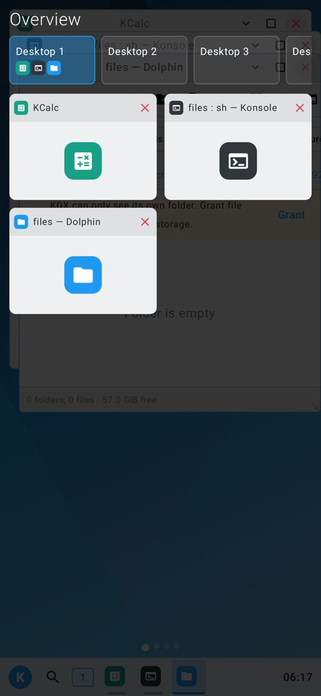
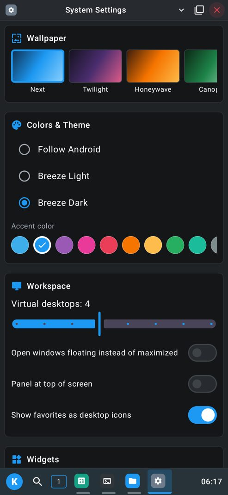
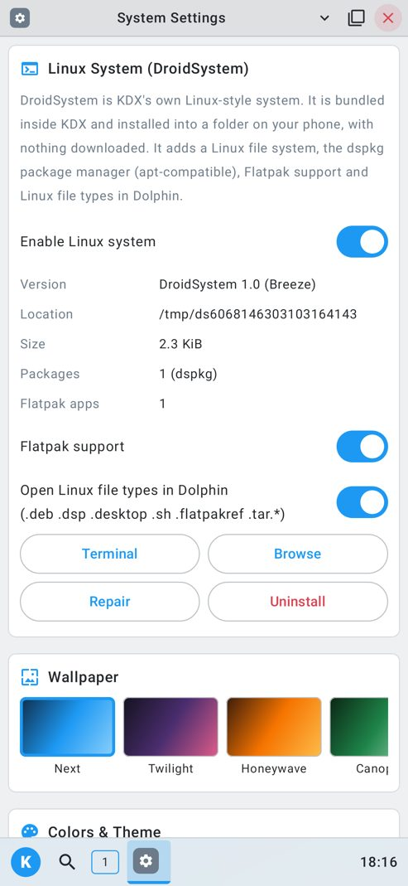
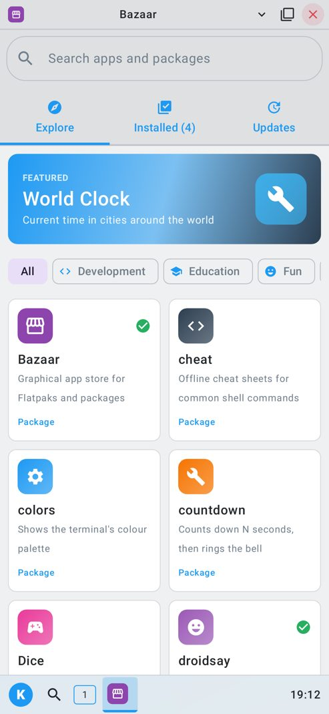
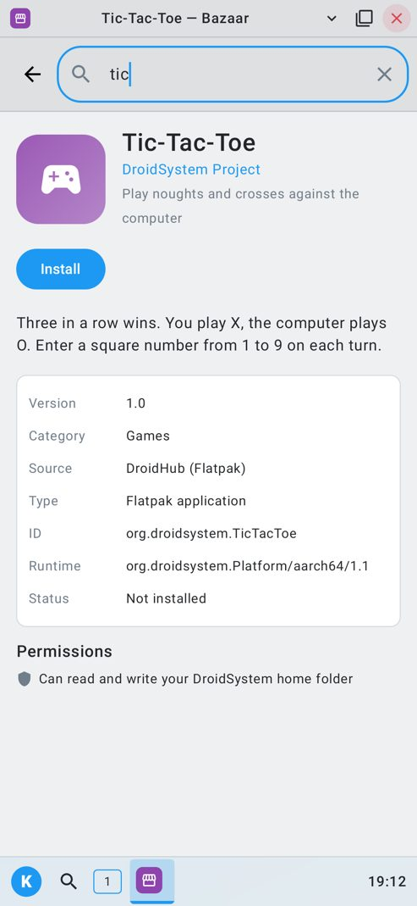
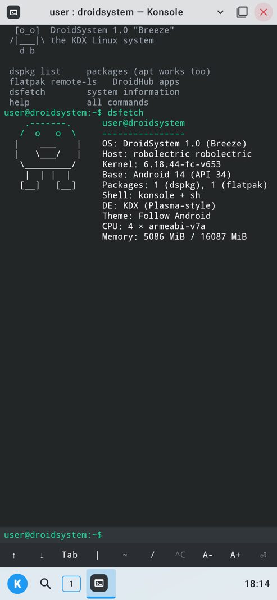

# KDX: a KDE Plasma–style workspace for Android

KDX is a native Android app (Kotlin + Jetpack Compose) that brings the KDE Plasma
desktop experience to phones, tablets and desktop-mode Android (DeX, Chromebooks, external displays).
It runs as a **home-screen launcher**, so it can fully replace your Android home screen.

| Desktop | Kickoff | KRunner | Floating windows |
|---|---|---|---|
|  |  |  |  |
| **Overview** | **Breeze Dark** | **Clock & calendar** | **Konsole** |
|  |  |  |  |

## Features

### Plasma shell
- **Panel** with application launcher, KRunner button, pager, task manager and system tray (battery, clock, Klipper). Can sit at the bottom or the top.
- **Kickoff** launcher: Favorites, all applications (KDX apps plus every installed Android app) with categories, Places, and Leave. Search ranks matches. Long-press an app to favourite it, open App info or uninstall it.
- **KRunner**: calculator (`2^10 + sqrt(81)`), unit conversion (`10 km to mi`, `72 f in c`), web shortcuts (`gg:`, `dd:`, `wp:`, `yt:`, `gh:`, `kde:`, `map:`, `play:`), URLs, paths (`~/Download`), shell commands (`> uname -a`), open windows, Android settings pages, clipboard history and desktops (`desktop 2`).
- **Window manager** (a small KWin): floating or maximized windows that you can move, resize, minimize, maximize, close, and keep above others. Includes the window menu, click-to-focus and cascade placement.
- **Virtual desktops** (1–8): pager in the panel, swipe on the wallpaper to switch, and "Move to Desktop N" for windows.
- **Overview**: the desktop strip plus a grid of the open windows.
- **Desktop widgets**: Digital Clock, System Load and a Sticky Note. The clock pops up a month calendar.
- **Breeze theming**: Breeze Light / Dark / follow Android, 10 accent colours, 5 built-in wallpapers or your own image.
- **Plasma keyboard shortcuts** for hardware keyboards: Meta, Alt+Space, Alt+F2, Meta+W, Meta+D, Alt+Tab, Alt+F4, Meta+↑/↓, Ctrl+F1–F8, Ctrl+Meta+←/→, Ctrl+Alt+T, Meta+E, Meta+V.

### KDE applications, rebuilt for Android
| App | What it does |
|---|---|
| **Dolphin** | File manager: Places, breadcrumbs, back/forward/up, list and grid views with thumbnails, filter, hidden files, multi-select, copy/cut/paste between windows, rename, delete, properties, share, "Open with…", "Open Terminal Here" |
| **Konsole** | Terminal on Android's `sh`: streaming output, stdin to running programs, Ctrl+C, history, Tab completion, extra-keys row, `cd`, plus built-ins that open KDX apps |
| **Kate** | Text editor: line numbers, find & replace, undo/redo, word wrap, zoom, Save / Save As, status bar |
| **KCalc** | Scientific calculator: memory, degrees/radians, history tape |
| **Gwenview** | Image viewer: thumbnail browser, pinch zoom, next/previous, share, set as wallpaper |
| **Klipper** | Clipboard history with search |
| **KNotes** | Sticky notes (shared with the desktop widget) |
| **System Monitor** | Live memory and CPU-frequency graphs, battery, storage, uptime |
| **Info Center** | Software, hardware and display information |
| **System Settings** | Wallpaper, colours, desktops, panel, widgets, clock, shortcuts, Android integration |

## Linux system: DroidSystem
Turn it on in **System Settings → Linux System (DroidSystem)**. KDX installs **DroidSystem**, its own Linux-style
system, into a `DroidSystem/` folder on your phone (or KDX's private folder if file access hasn't been granted).
DroidSystem is written for KDX and bundled inside the APK (`app/src/main/assets/droidsystem`), so **nothing is downloaded**.

| Settings | Bazaar | App page | dsfetch |
|---|---|---|---|
|  |  |  |  |

- **Bazaar** (installed by default): a graphical app store with Explore (featured app and categories), Installed and
  Updates tabs, search, app pages with version/source/permissions, and one-tap Install / Open / Remove / Update for
  Flatpaks and dspkg packages. Open it from Kickoff or type `bazaar` in Konsole.

- **File system**: `etc/` (os-release, passwd, motd, profile), `home/user`, `usr/bin`, `usr/share/applications`, `var/lib/{dspkg,flatpak}`, …
- **Konsole becomes a DroidSystem shell** (`user@droidsystem:~$`) with `dsfetch`, `droidsystem`, `extract`, `linuxinfo`, `run-desktop`.
- **dspkg** package manager (`apt`/`apt-get` work as aliases): `update`, `list`, `search`, `show`, `install`, `remove`, `build`.
  - Offline *main* repo: `droidsay`, `fortune`, `tree`, `todo`, `sysinfo`, `countdown`, `cheat`, `rot13`, `wordcount`, `colors`
  - Installs Debian **.deb**, Fedora/openSUSE **.rpm**, Arch **.pkg.tar.{gz,xz}** and DroidSystem's own **.dsp** packages
    (`dspkg build DIR` creates one); `dspkg upgrade` updates to the bundled versions
- **Flatpak**: `flatpak list | remotes | remote-ls | search | info | install | uninstall | run`. It installs Flatpak build
  directories (`metadata` + `files/`, as a folder, .zip or .tar.*) and `.flatpakref` files that point at the offline **DroidHub**
  remote: Welcome Tour, Dice, Number Guess, Tic-Tac-Toe, Hangman, Password Generator, World Clock, Quick Notes.
  `.flatpakrepo` files can be added with `flatpak remote-add`.
- **A better shell**: installed commands are shell functions, so pipes and scripts work (`fortune | droidsay`), and
  built-ins pipe too (`dspkg list | grep game`). Konsole shows prompts that don't end in a newline, handles `\r` progress
  lines, and renders ANSI colours (try `colors`). An older DroidSystem upgrades itself automatically.
- **Linux apps in Kickoff**: `.desktop` launchers from packages and Flatpaks appear under **Applications → Linux**.
- **Linux file types in Dolphin**: `.deb`/`.rpm`/`.pkg.tar.*`/`.dsp` install, `.flatpakref`/`.flatpakrepo` install,
  `.desktop` launches, `.sh` runs, `.tar.*`/`.zip`/`.7z`/`.jar`/`.gz`/`.xz`/`.bz2`/`.cpio` extract, and
  `.AppImage`/ELF/`.so`/`.ko`/`.iso`/`.img`/squashfs files are identified by their contents. Linux config and source files
  (`.service`, `.spec`, `.patch`, `PKGBUILD`, `Makefile`, …) open in Kate. Folders with a `metadata` file get *Install as Flatpak*.

**Android limit:** Android does not let apps execute downloaded native Linux programs (W^X policy, and there is no glibc).
Packages and Flatpaks containing desktop-Linux binaries can be installed and inspected, but only script-based apps
(like everything DroidSystem ships) actually run.

## Install
Download `app-release.apk` from the latest **Build KDX** run in GitHub Actions (artifact `KDX-apk`) and install it.
To use KDX as your home screen: *Kickoff → Leave → Default Home App*, then choose **KDX**.

For Dolphin to browse all of your storage, tap **Grant** in its banner. This opens Android's "All files access" setting.

## Build
Requires JDK 17+ and the Android SDK (platform 35).
```bash
./gradlew assembleRelease        # app/build/outputs/apk/release/app-release.apk
./gradlew testDebugUnitTest      # unit tests + Robolectric UI tests (screenshots in app/build/screenshots)
```

## Limits
Android sandboxing rules out some things that real Plasma does. KDX cannot run Linux/Qt KDE binaries,
draw other Android apps inside its own windows (they open full-screen as usual), lock the screen,
or read the clipboard while it is in the background. Konsole is a line-based shell, not a full VT100 terminal,
so `vim`/`top`-style full-screen programs don't render.

KDX is an independent project inspired by KDE. It is not affiliated with or endorsed by KDE e.V.
