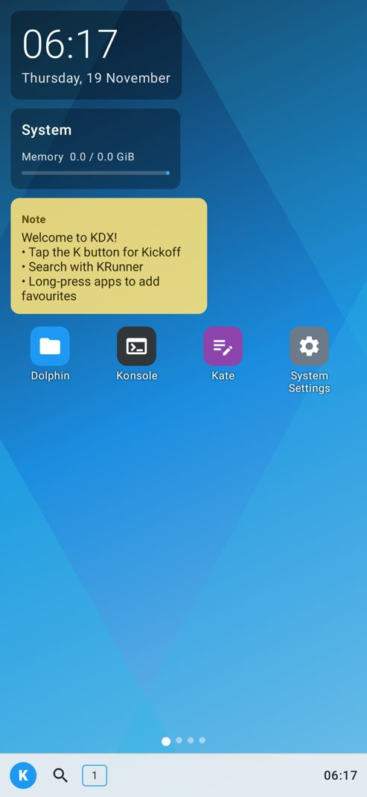
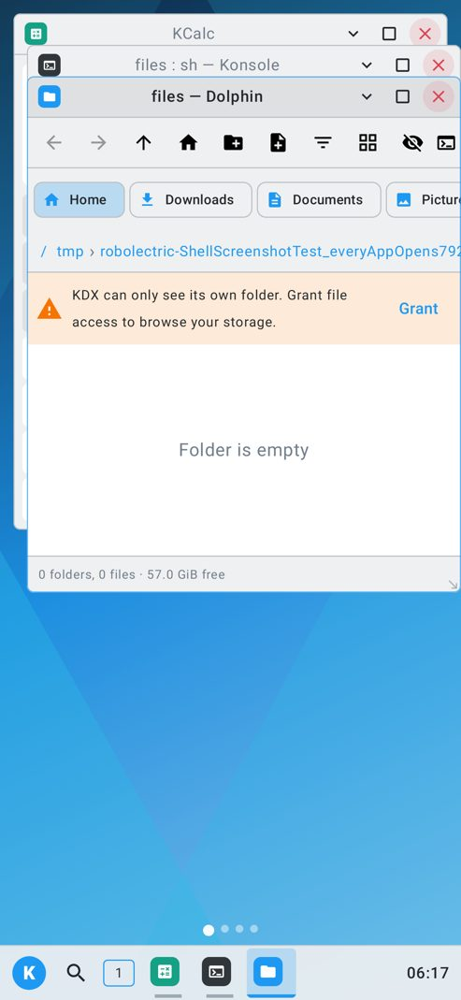
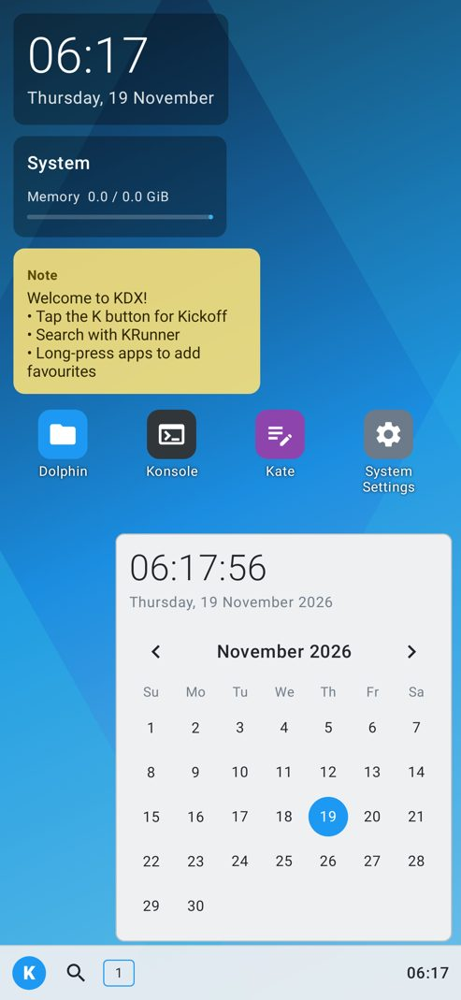
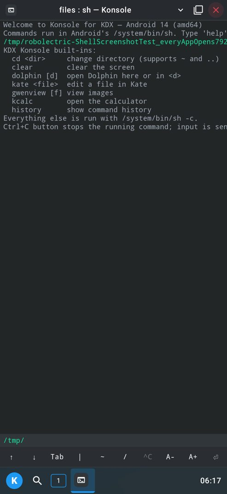

# KDX: a KDE Plasma–style workspace for Android

KDX is a native Android app (Kotlin + Jetpack Compose) that brings the KDE Plasma
desktop experience to phones, tablets and desktop-mode Android (DeX, Chromebooks, external displays).
It runs as a **home-screen launcher**, so it can fully replace your Android home screen.

| Desktop | Kickoff | KRunner | Floating windows |
|---|---|---|---|
|  |  |  |  |
| **Overview** | **Breeze Dark** | **Clock & calendar** | **Konsole** |
|  |  |  |  |

## Features

### Plasma shell
- **Panel** with application launcher, KRunner button, pager, task manager and system tray (battery, clock, Klipper). Can sit at the bottom or the top.
- **Kickoff** launcher: Favorites, all applications (KDX apps plus every installed Android app) with categories, Places, and Leave. Search ranks matches. Long-press an app to favourite it, open App info or uninstall it.
- **KRunner**: calculator (`2^10 + sqrt(81)`), unit conversion (`10 km to mi`, `72 f in c`), web shortcuts (`gg:`, `dd:`, `wp:`, `yt:`, `gh:`, `kde:`, `map:`, `play:`), URLs, paths (`~/Download`), shell commands (`> uname -a`), open windows, Android settings pages, clipboard history and desktops (`desktop 2`).
- **Window manager** (a small KWin): floating or maximized windows that you can move, resize, minimize, maximize, close, and keep above others. Includes the window menu, click-to-focus and cascade placement.
- **Virtual desktops** (1–8): pager in the panel, swipe on the wallpaper to switch, and "Move to Desktop N" for windows.
- **Overview**: the desktop strip plus a grid of the open windows.
- **Desktop widgets**: Digital Clock, System Load and a Sticky Note. The clock pops up a month calendar.
- **Breeze theming**: Breeze Light / Dark / follow Android, 10 accent colours, 5 built-in wallpapers or your own image.
- **Plasma keyboard shortcuts** for hardware keyboards: Meta, Alt+Space, Alt+F2, Meta+W, Meta+D, Alt+Tab, Alt+F4, Meta+↑/↓, Ctrl+F1–F8, Ctrl+Meta+←/→, Ctrl+Alt+T, Meta+E, Meta+V.

### KDE applications, rebuilt for Android
| App | What it does |
|---|---|
| **Dolphin** | File manager: Places, breadcrumbs, back/forward/up, list and grid views with thumbnails, filter, hidden files, multi-select, copy/cut/paste between windows, rename, delete, properties, share, "Open with…", "Open Terminal Here" |
| **Konsole** | Terminal on Android's `sh`: streaming output, stdin to running programs, Ctrl+C, history, Tab completion, extra-keys row, `cd`, plus built-ins that open KDX apps |
| **Kate** | Text editor: line numbers, find & replace, undo/redo, word wrap, zoom, Save / Save As, status bar |
| **KCalc** | Scientific calculator: memory, degrees/radians, history tape |
| **Gwenview** | Image viewer: thumbnail browser, pinch zoom, next/previous, share, set as wallpaper |
| **Klipper** | Clipboard history with search |
| **KNotes** | Sticky notes (shared with the desktop widget) |
| **System Monitor** | Live memory and CPU-frequency graphs, battery, storage, uptime |
| **Info Center** | Software, hardware and display information |
| **System Settings** | Wallpaper, colours, desktops, panel, widgets, clock, shortcuts, Android integration |

## Linux system: DroidSystem 2 (Debian-based)
Turn it on in **System Settings → Linux System (DroidSystem)**. DroidSystem 2 is **based on Debian** and runs real
Linux software:

- **Real Debian** – KDX builds it like `debootstrap` does: it downloads the official Debian trixie packages for your
  phone's CPU (arm64, armhf or amd64; about 35 MB, SHA-256 verified) and installs them, then adds the DroidSystem layer
  (branding, apt settings for proot, tools). It runs with **proot** (bundled, from Termux), so no root is needed.
- **apt works** in Konsole (`apt install cowsay`, `apt install gnome-mines`, …) – Konsole is a real Debian `bash`.
- **Linux apps with windows** each get **their own KDX window** with the app's **title** (live, e.g. the open
  document) and **icon** in the title bar and panel. Behind each window is its own X display (TigerVNC + Openbox,
  no extra title bar, app maximized) that **resizes to fit the window**. The **mouse pointer is hidden**, and input
  works like a **touchscreen**: tap = click, drag = scroll, long-press = right-click, long-press + drag = drag, two
  fingers = scroll / pinch-zoom (a Mouse mode is one tap away). Keyboard and Ctrl/Alt/Super/Esc/arrow keys are in
  the toolbar. The window closes when the app quits. Set up with `display-setup` (or the button in Settings), then
  run apps from Kickoff → Linux, Bazaar, or `gui <app>` in Konsole.
- **Flatpak** – `flatpak-setup` installs the real Flatpak and adds Flathub. Installing from **Bazaar** runs
  `flatpak install` for you, and **Open** starts the app on the Linux Display. Flatpak's own sandbox (bubblewrap) needs
  kernel features Android doesn't give apps, so KDX starts Flatpak apps itself in the same layout (runtime as `/usr`,
  app as `/app`, Flatpak's environment) using proot. It mounts **runtime and app extensions** (Mesa GL drivers,
  codecs, themes, plugins) the way Flatpak does, provides a **D-Bus session bus**, forces X11 for Wayland-first and
  Electron apps, and turns off Chromium/Electron's internal sandbox (it needs kernel namespaces). Libraries that
  run helpers in their own bubblewrap sandbox – glycin (image loading in GNOME 47+ apps) and WebKitGTK – are given a
  `bwrap` that reports "no namespaces", so they run the helpers directly instead of failing. Verified with
  **Kitties** (`io.github.Micro856.KittiesGtk`, GNOME 51 runtime): it starts, fetches and shows pictures.
  Firefox's own sandboxes (seccomp/namespaces) are turned off with Mozilla's `MOZ_DISABLE_*_SANDBOX` variables, as
  Termux users do; **Firefox** (`org.mozilla.firefox`) starts and renders pages this way.
- If a Linux app stops right after starting or with an error, its window stays open and explains why (e.g. Android
  ended it for memory, a blocked system call, a crash) with the app's log, **Restart** and **Copy log**. Not supported:
  "extra-data" apps that download proprietary files at install time (they need bubblewrap), and apps that require a
  real GPU (rendering is software-only).
- Installed Debian and Flatpak apps appear in **Kickoff → Applications → Linux** with their own icons.

To run downloaded programs KDX must target **Android 9** (like Termux), so it's installed by sideloading rather than
from Google Play. See [THIRD_PARTY_NOTICES.md](THIRD_PARTY_NOTICES.md) for the bundled proot binaries.

**What's tested:** the Debian bootstrap, apt, the X display + VNC client and the Flatpak launcher are exercised by
`DebianIntegrationTest` (`./gradlew testDebugUnitTest -Pkdx.integration=/tmp/kdx-it`) on x86_64 Linux. Running
`flatpak install` itself needs a proot that handles modern system calls such as `statx` – Termux's proot (the one
bundled for phones) does; older distribution proot builds don't.

### DroidSystem's own layer
DroidSystem's folder lives in the phone's **Android folder**: `/storage/emulated/0/Android/DroidSystem` (on a PC:
`…/Internal storage/Android/DroidSystem`). If Android refuses new folders there, KDX uses
`Android/data/org.kdx.shell/files/DroidSystem` instead – also inside the Android folder, but removed when KDX is
uninstalled. Installs from older versions at `/storage/emulated/0/DroidSystem` are moved automatically. The Debian
system files themselves stay in KDX's private storage, because Android doesn't allow programs or symlinks on shared
storage.

DroidSystem also keeps its original, fully offline layer in that folder (mounted at
`/home/user` inside Debian), bundled inside the APK (`app/src/main/assets/droidsystem`):

| Settings | Bazaar | Flathub app | DroidSystem app |
|---|---|---|---|
|  |  |  |  |

- **Bazaar** (installed by default): a graphical app store. It loads the **live Flathub catalog** (trending, popular,
  new, ten categories, search) with real icons, screenshots, descriptions, sizes, install counts and permissions, and
  caches it for offline use. Flathub apps are desktop Linux programs Android can't run, so their Install button explains
  that and offers to save the `.flatpakref` (for a Linux PC) or find an Android version on Google Play. Apps marked
  **Runs on DroidSystem** install, open, update and remove with one tap. The Flathub catalog can be turned off from
  Bazaar's menu. Open Bazaar from Kickoff or type `bazaar` in Konsole.

- **File system**: `etc/` (os-release, passwd, motd, profile), `home/user`, `usr/bin`, `usr/share/applications`, `var/lib/{dspkg,flatpak}`, …
- **Konsole becomes a DroidSystem shell** (`user@droidsystem:~$`) with `dsfetch`, `droidsystem`, `extract`, `linuxinfo`, `run-desktop`.
- **dspkg** package manager (`apt`/`apt-get` work as aliases): `update`, `list`, `search`, `show`, `install`, `remove`, `build`.
  - Offline *main* repo: `droidsay`, `fortune`, `tree`, `todo`, `sysinfo`, `countdown`, `cheat`, `rot13`, `wordcount`, `colors`
  - Installs Debian **.deb**, Fedora/openSUSE **.rpm**, Arch **.pkg.tar.{gz,xz}** and DroidSystem's own **.dsp** packages
    (`dspkg build DIR` creates one); `dspkg upgrade` updates to the bundled versions
- **Flatpak**: `flatpak list | remotes | remote-ls | search | info | install | uninstall | run`. It installs Flatpak build
  directories (`metadata` + `files/`, as a folder, .zip or .tar.*) and `.flatpakref` files that point at the offline **DroidHub**
  remote: Welcome Tour, Dice, Number Guess, Tic-Tac-Toe, Hangman, Password Generator, World Clock, Quick Notes.
  `.flatpakrepo` files can be added with `flatpak remote-add`.
- **A better shell**: installed commands are shell functions, so pipes and scripts work (`fortune | droidsay`), and
  built-ins pipe too (`dspkg list | grep game`). Konsole shows prompts that don't end in a newline, handles `\r` progress
  lines, and renders ANSI colours (try `colors`). An older DroidSystem upgrades itself automatically.
- **Linux apps in Kickoff**: `.desktop` launchers from packages and Flatpaks appear under **Applications → Linux**.
- **Linux file types in Dolphin**: `.deb`/`.rpm`/`.pkg.tar.*`/`.dsp` install, `.flatpakref`/`.flatpakrepo` install,
  `.desktop` launches, `.sh` runs, `.tar.*`/`.zip`/`.7z`/`.jar`/`.gz`/`.xz`/`.bz2`/`.cpio` extract, and
  `.AppImage`/ELF/`.so`/`.ko`/`.iso`/`.img`/squashfs files are identified by their contents. Linux config and source files
  (`.service`, `.spec`, `.patch`, `PKGBUILD`, `Makefile`, …) open in Kate. Folders with a `metadata` file get *Install as Flatpak*.

**Android limit:** Android does not let apps execute downloaded native Linux programs (W^X policy, and there is no glibc).
Packages and Flatpaks containing desktop-Linux binaries can be installed and inspected, but only script-based apps
(like everything DroidSystem ships) actually run.

## Install
Download `app-release.apk` from the latest **Build KDX** run in GitHub Actions (artifact `KDX-apk`) and install it.
To use KDX as your home screen: *Kickoff → Leave → Default Home App*, then choose **KDX**.

For Dolphin to browse all of your storage, tap **Grant** in its banner. This opens Android's "All files access" setting.

## Build
Requires JDK 17+ and the Android SDK (platform 35).
```bash
./gradlew assembleRelease        # app/build/outputs/apk/release/app-release.apk
./gradlew testDebugUnitTest      # unit tests + Robolectric UI tests (screenshots in app/build/screenshots)
```

## Limits
Android sandboxing rules out some things that real Plasma does. KDX cannot run Linux/Qt KDE binaries,
draw other Android apps inside its own windows (they open full-screen as usual), lock the screen,
or read the clipboard while it is in the background. Konsole is a line-based shell, not a full VT100 terminal,
so `vim`/`top`-style full-screen programs don't render.

KDX is an independent project inspired by KDE. It is not affiliated with or endorsed by KDE e.V.
